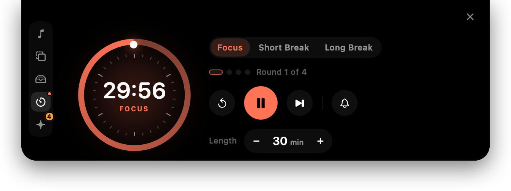
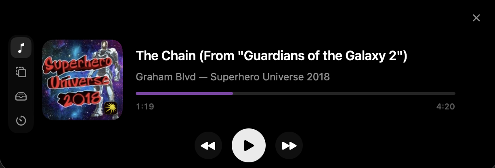
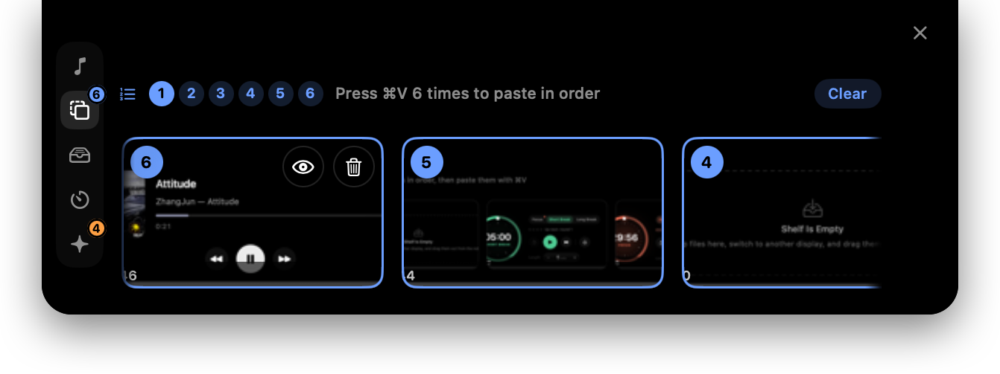
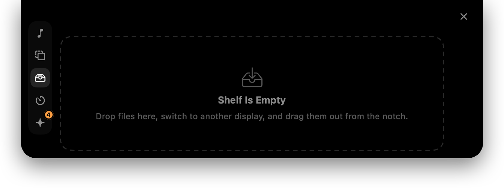
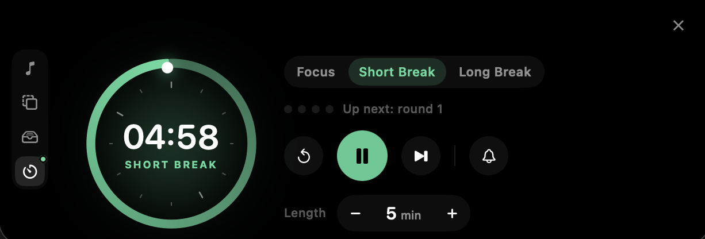

<div align="center">

# Clipnotch

**The MacBook notch, put to work.** A now-playing player, a clipboard queue that
pastes several screenshots in a row, a file shelf, and a pomodoro timer — all in
a panel that unfolds from the hardware cutout.




</div>

---

## Why

The notch is dead screen area you look at all day. Clipnotch fills it with the
four things that otherwise cost a window each — and stays out of the way the
rest of the time: the closed strip only widens when something is actually
happening, and the panel never steals focus from what you are typing in.

Built for macOS 14+, tested on macOS 26.5. Inspired by
[boring.notch](https://github.com/TheBoredTeam/boring.notch), written from
scratch. English and Russian.

## The four panes

<table>
<tr><td width="50%">

### ♪ Now Playing



Artwork, title, artist, album, a draggable scrubber and transport. Reads the
**system-wide** now-playing session, so it works for anything that publishes to
it — Spotify, Apple Music, a YouTube tab, Yandex Music, VLC. The artwork flies
between the closed strip and the open panel rather than fading.

</td><td width="50%">

### ⧉ Clipboard



Screenshots, text and files you copy, as cards. Click them **in order** to arm
a paste queue, then press `⌘V` once per clip in the destination app. Preview an
image full size, or delete a clip, from the card itself.

</td></tr>
<tr><td width="50%">

### ⌸ Shelf



Drop files anywhere on the panel and they park here — then drag them out on a
different display, without holding the mouse button down the whole journey.
Items are references, not copies: the destination decides move or copy, and a
file deleted on disk drops off the shelf.

</td><td width="50%">

### ◷ Pomodoro



Four focus rounds, a short break after each, a long one after the fourth. Any
length from 1 to 120 minutes, set from the stepper. Each phase keeps its own
remaining time and exactly one of them ticks, so switching tabs to look at a
break never stops the focus round that is running.

</td></tr>
</table>

## The paste queue

The point of the clipboard pane:

1. Take several screenshots (`⌘⇧4`, straight to the clipboard as usual).
2. Hover the notch, or press `⌘⇧V`, and open the **Clipboard** tab.
3. Click the clips **in the order you want them**. Each gets a number badge.
4. Go back to your editor and press `⌘V` once per clip. Each press pastes the
   next one in the queue.
5. When the queue drains, your original clipboard is restored.

Why it works this way: Clipnotch never synthesises a `⌘V`. It pre-arms the
system pasteboard with the head of the queue and installs a **listen-only**
event tap. Your real keystroke does the pasting; the tap only notices it
happened and swaps the next clip in afterwards. A bug here can leave the wrong
clip armed, but it can never break `⌘V`.

Copying something new outside the app cancels the queue — that's the escape
hatch, along with the **Clear** button and the menu bar item.

## The pomodoro

The dial is the phase itself, not a clock face: full when the phase starts,
empty when it runs out, so a five-minute break reads exactly like a
twenty-five-minute focus round. Tick marks are spaced one per minute of that
phase.

Time is stored as an end date, never a ticking counter — nothing in the app
publishes once a second, and a sleeping Mac still counts down. Each phase keeps
its own remaining time, and `runningPhase` names the one that ticks:

| You do | What happens |
|---|---|
| Switch tabs | Nothing starts, nothing stops. The running phase keeps running, and its tab shows a dot |
| Press play on another phase | The one that was running parks where it stands; the new one starts |
| Press pause | That phase stops, and keeps its remaining time for later |
| Change the length, reset, skip | The phase restarts at the top — still running, if it was running |
| The phase runs out | The chime plays, the cycle advances, and the next phase waits on the line |

## Install

### Download

[**Download Clipnotch**](https://github.com/aspan21/Clipnotch/releases/latest) —
universal (Apple silicon and Intel), macOS 14+.

1. Open the `.dmg` and drag **Clipnotch** onto **Applications**.
2. The build is ad-hoc signed and not notarised, so macOS blocks the first
   launch. Right-click **Clipnotch** in Applications → **Open** → **Open** in the
   dialog. On macOS 15+ the dialog may only show up under **System Settings →
   Privacy & Security → Open Anyway**. The one-liner does the same thing:

   ```bash
   xattr -dr com.apple.quarantine /Applications/Clipnotch.app
   ```

3. Grant Accessibility access: **System Settings → Privacy & Security →
   Accessibility** → **+** → pick Clipnotch, switch it on, then relaunch the
   app. Without it, clicking a clip only copies it — nothing gets pasted. See
   [Accessibility permission](#accessibility-permission).

Clipnotch runs from the menu bar and has no Dock icon. Move the pointer over
the notch to unfold the panel.

### Build from source

Needs only the Command Line Tools — no Xcode.

```bash
git clone https://github.com/aspan21/Clipnotch.git
cd Clipnotch
./build.sh          # -> build/Clipnotch.app
open build/Clipnotch.app
```

`build.sh` runs SwiftPM, assembles the `.app` by hand, copies the adapter
resources in, and signs it. It builds for this Mac's architecture only and
leaves the bundle inside the checkout — nothing is copied to `/Applications`.

`./package.sh` produces the distributable image instead: a universal binary,
signed, inside `dist/Clipnotch-<version>.dmg` laid out for drag-and-drop. With
a Developer ID certificate in the keychain it signs with that, and
`NOTARY_PROFILE=<notarytool profile> ./package.sh` also notarises and staples
the result, which removes the Gatekeeper step above.

## Controls

| Action | How |
|---|---|
| Open / close panel | Hover the notch, or click it |
| Open on a display without a notch | Double-click the strip, or hold the pointer against the top edge for 3 seconds — passing over it never opens it, so browser tabs stay reachable |
| Open clipboard directly | `⌘⇧V` — change it, or add shortcuts for the other panes and for pomodoro start / pause, in Settings |
| Switch pane | The icon rail down the left edge |
| Add clip to queue | Click a card |
| Remove from queue | Click a queued card again |
| Preview an image full size | Hover a card, click the eye |
| Delete a clip | Hover a card, click the trash |
| Clear the queue | **Clear** in the queue bar |
| Shelve files | Drop them anywhere on the panel, open or closed |
| Start / pause a phase | Play on the phase you are looking at |
| Set a phase length | **−** / **+** beside the dial; hold to run, and then to leap |
| See which Claude Code session waits on you | The notch shows a pulsing icon and a count until you open the session; the **Agents** tab lists them — click one to bring its terminal forward |
| Settings, quit | Menu bar icon |

## Settings

| | |
|---|---|
| **General** | Open at login |
| **Claude Code** | Install or remove the radar's hooks (shown as a diff of `~/.claude/settings.json` first, backed up before writing); sound on or off |
| **History** | Cap by clips (default 200) and by age (default 7 days); skip what password managers mark private; clear now |
| **Panel** | Open on hover; show over full-screen apps; notch height override for displays it guesses wrong |
| **Shortcuts** | Record or clear each global shortcut; a warning shows when another app already owns one |
| **Paste Queue** | Accessibility status, and the delay between the intercepted paste and arming the next clip |

## Under the hood

**Now Playing.** Apple restricted the private MediaRemote framework in macOS
15.4. The way around it is
[mediaremote-adapter](https://github.com/ungive/mediaremote-adapter) by Jonas
van den Berg (BSD-3-Clause): the framework is loaded inside `/usr/bin/perl`,
which is still entitled to use it, and now-playing state is streamed back as
NDJSON. Progress is extrapolated from `elapsedTime` plus `playbackRate`, so the
bar moves smoothly between stream updates.

**The window.** One borderless, non-activating `NSPanel` above the menu bar,
joined to a max-level private CoreGraphics space so it stays visible over
full-screen apps. It never becomes key — which is why nothing in the panel is a
text field.

**The shape.** One animatable frame interpolates between the closed strip and
the open panel; the content inside is pinned at full size and revealed, rather
than re-laid-out on every frame.

**History on disk.** Payloads live in
`~/Library/Application Support/Clipnotch/`, images as PNG files plus a JSON
index. Auto-purge runs on launch and after every insert, and deletes the files,
not just the index entries. Content marked `org.nspasteboard.ConcealedType` is
skipped and never written to disk.

## Accessibility permission

The event tap needs Accessibility access. Until it is granted, clicking a clip
just copies it (no sequencing). Grant it in
**System Settings → Privacy & Security → Accessibility**.

macOS ties the grant to the app's signature, not its path. An **ad-hoc**
signature is identified by the binary's hash, so every rebuild looks like a
different app and the grant has to be given again. Signing with a stable local
certificate instead makes the designated requirement
`identifier "com.github.aspan21.clipnotch" and certificate leaf = H"..."`, which
survives rebuilds — grant it once and it stays.

`build.sh` uses the certificate named **Clipnotch Local Signing** if it finds
one, and says so; otherwise it falls back to ad-hoc and warns that the grant
will need re-giving. To create it:

```bash
openssl req -x509 -newkey rsa:2048 -sha256 -days 7300 -nodes \
  -keyout key.pem -out cert.pem \
  -subj "/CN=Clipnotch Local Signing" \
  -addext "basicConstraints=critical,CA:false" \
  -addext "keyUsage=critical,digitalSignature" \
  -addext "extendedKeyUsage=critical,codeSigning"

# LibreSSL, not OpenSSL 3: `security import` cannot read the newer PKCS#12
# encryption that OpenSSL 3 writes by default.
/usr/bin/openssl pkcs12 -export -inkey key.pem -in cert.pem \
  -out bundle.p12 -passout pass:clipnotch -name "Clipnotch Local Signing"

security import bundle.p12 -k ~/Library/Keychains/login.keychain-db \
  -P clipnotch -T /usr/bin/codesign

# Prompts for the keychain password. Until this runs, `security find-identity
# -v -p codesigning` reports the identity as invalid and build.sh stays ad-hoc.
security add-trusted-cert -r trustRoot -p codeSign \
  -k ~/Library/Keychains/login.keychain-db cert.pem

rm key.pem bundle.p12   # the private key now lives in the keychain
```

The certificate is self-signed and trusted only in this machine's user trust
settings. It is for keeping a local TCC grant stable — it says nothing about
the app's provenance to anyone else. The public certificate is kept at
`~/Library/Application Support/Clipnotch/local-signing-cert.pem`.

After switching from ad-hoc to the certificate, remove and re-add Clipnotch in
the Accessibility pane once — the old ad-hoc grant does not carry over.

## Layout

```
Sources/Clipnotch/
  main.swift, AppDelegate.swift
  Core/          settings, logging
  Notch/         window, CGS private space, notch shape, geometry, open/close state
  NowPlaying/    perl adapter bridge, observable model
  Clipboard/     capture, on-disk store, pasteboard read/write
  Paste/         paste queue + event tap, Accessibility state
  Shelf/         parked files, drag in and out
  Pomodoro/      phase cycle, chime
  Hotkey/        Carbon RegisterEventHotKey wrapper
  UI/            SwiftUI views, menu bar, settings window
Resources/
  Localization/  en, ru
docs/capture.sh  screenshots of the open panel, for this README
```

## Third-party

- [mediaremote-adapter](https://github.com/ungive/mediaremote-adapter) — BSD-3-Clause
- `Notch/CGSSpace.swift` derived from [Parrot](https://github.com/avaidyam/Parrot) — MPL-2.0

No other dependencies.
